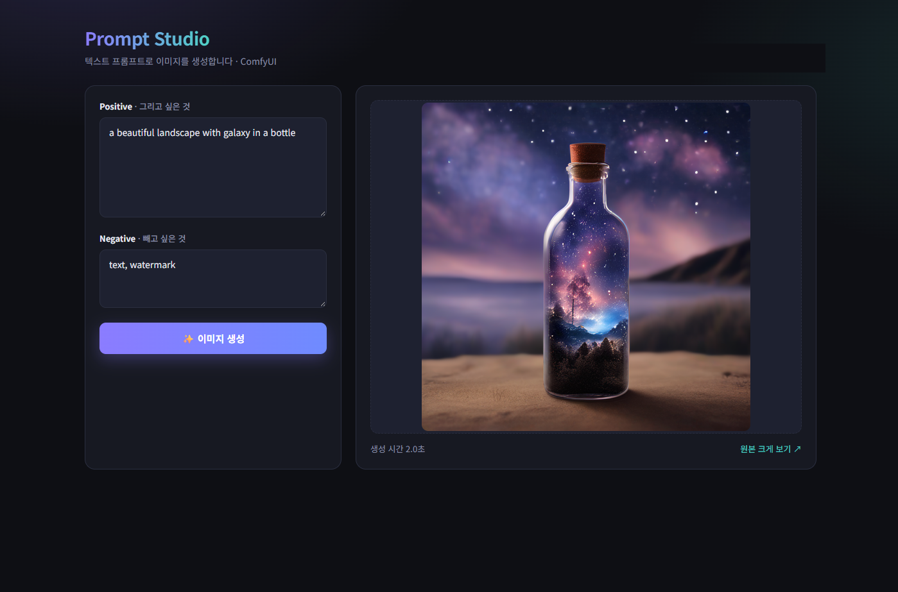

# ComfyUI + SDXL Turbo 이미지 생성 실습

한국폴리텍대학 「딥러닝프로그래밍기초」 Chapter 3 (이미지생성AI - ComfyUI) 실습 정리.
Docker 컨테이너에 ComfyUI를 설치하고, **SDXL Turbo** 모델로 Text-to-Image 생성을 해본 뒤
ComfyUI API를 Flask 웹 페이지(Prompt Studio)에 연결하고, 그 웹을 VMware VM의 Docker 컨테이너로 배포하는 것까지 진행했다.
마지막으로 요청 주소만 바꿔서 다른 PC의 ComfyUI(Flux2 모델)에 요청하는 실습도 했다.



> 수업 자료는 SD 1.5(`v1-5-pruned-emaonly-fp16`) 기준이지만, 이 저장소는 SDXL Turbo로 바꿔서 실습했다.
> 그래서 KSampler 설정값이 수업 자료와 다르다. ([4. SDXL Turbo 설정](#4-sdxl-turbo-설정) 참고)

## 실습 환경

| 항목 | 내용 |
|---|---|
| 실행 환경 | Docker (`python:3.12-slim`), NVIDIA GPU |
| UI | [ComfyUI](https://github.com/comfyanonymous/ComfyUI) |
| 모델 | [stabilityai/sdxl-turbo](https://huggingface.co/stabilityai/sdxl-turbo) - `sd_xl_turbo_1.0_fp16.safetensors` (약 7GB) |
| 웹 서버 | Flask + requests (VMware VM의 Docker 컨테이너에서 실행) |
| 코드 편집 | VS Code (`/workspace/comfyui` 에서 파일 편집) |
| 개발 컨테이너 | Dev Container (Python 3.12 Slim 기반) |
| 서버 접속 | PuTTY 로 원격 Ubuntu 서버에 SSH 접속 |

```
[브라우저] ──► [VMware VM: Docker 컨테이너 (Flask)] ──► [GPU 서버: ComfyUI :8188]
```

## 폴더 구조

```
.
├── README.md
├── app.py                # Flask 서버 (ComfyUI API 호출, SDXL Turbo용)
├── app_flux2.py          # Flux2 워크플로용 버전 (10번 실습)
├── requirements.txt      # flask, requests
├── Dockerfile            # 웹 서버 이미지 빌드 설정
├── templates/
│   └── image.html        # 웹 화면 (Prompt Studio)
├── static/
│   ├── test.json         # SDXL Turbo 워크플로 (ComfyUI "내보내기(API)")
│   └── flux2.json        # Flux2 워크플로 (10번 실습)
├── docs/
│   └── deploy_vm_guide.md  # VM 배포 상세 가이드
└── images/               # 결과 이미지, 캡처
```

모델 파일(`.safetensors`)은 용량이 커서 깃허브에 올리지 않는다. (`.gitignore` 처리)

---

## 1. 개념 정리

**이미지 생성 기술**

- 기술적 기반: GAN, VAE, Diffusion Model, Transformer + Denoising
- 주요 모델: DALL-E 2/3, Midjourney, Imagen, Stable Diffusion, Adobe Firefly
- 작동 원리: 텍스트 이해 → 이미지 생성 → 스타일 적용 → 정교화

**Text-to-Image 구조**

| 구성 요소 | 역할 |
|---|---|
| 텍스트 인코더 | 주로 CLIP. 프롬프트를 벡터 공간으로 변환 |
| 프라이어(Prior) | 텍스트 임베딩을 이미지 임베딩으로 매핑 |
| 디코더 | 이미지 임베딩을 실제 이미지로 변환 |

**Stable Diffusion 활용 포인트**

- 프롬프트: 주제를 정한 뒤 상황, 동작, 형용사를 붙여 구체화
- 파라미터: Sampling method, Steps, CFG Scale(높을수록 프롬프트 충실도 증가), Seed
- 모델: 체크포인트(기본 모델) + LoRA(경량 보조 모델) 조합
- 네거티브 프롬프트: `low quality, worst quality` 처럼 빼고 싶은 요소 지정

---

## 2. ComfyUI 설치

```bash
# 1) 컨테이너 생성 / 접속
docker run -d -it --gpus=all -p 8188:8188 --name comfyui python:3.12-slim /bin/bash
docker exec -it comfyui /bin/bash

# 2) PyTorch (CUDA 12.8)
pip install torch torchvision torchaudio --extra-index-url https://download.pytorch.org/whl/cu128

# 3) git, wget
apt update && apt install git wget -y

# 4) ComfyUI 클론 + 의존성 설치
git clone https://github.com/comfyanonymous/ComfyUI.git
cd ComfyUI
pip install -r requirements.txt
```

## 3. SDXL Turbo 모델 다운로드

`models/checkpoints/` 에 바로 받는다.

```bash
wget -P models/checkpoints/ \
  https://huggingface.co/stabilityai/sdxl-turbo/resolve/main/sd_xl_turbo_1.0_fp16.safetensors

ls -lh models/checkpoints/
```

실행:

```bash
python main.py --listen 0.0.0.0 --port 8188
```

브라우저에서 `http://127.0.0.1:8188` 접속.

## 4. SDXL Turbo 설정

수업 자료의 기본 템플릿은 `KSampler` 노드 하나로 샘플링하지만, SDXL Turbo는 전용 스케줄러를 쓰기 위해
`사용자 정의 샘플러(SamplerCustom)` + `SD-Turbo 스케줄러` + `KSampler (선택)` 조합으로 구성했다.
(실제 사용한 워크플로: [`static/test.json`](static/test.json))

**노드 연결**

```
체크포인트 로드 ─┬─ MODEL ─┬─────────────────────────► 사용자 정의 샘플러 ─► VAE 디코드 ─► 이미지 저장
(sd_xl_turbo)   │         └─► SD-Turbo 스케줄러 ─ SIGMAS ─►      ▲              ▲
                ├─ CLIP ──► CLIP 텍스트 인코딩 x2 (긍정/부정) ──►  │              │
                └─ VAE ───────────────────────────────────────────┼──────────────┘
KSampler (선택: euler_ancestral) ─ SAMPLER ───────────────────────┤
빈 잠재 이미지 (512 x 512) ─ LATENT ──────────────────────────────┘
```

**설정값 비교**

| 항목 | 수업 자료 (SD 1.5) | 이 실습 (SDXL Turbo) | 설정 위치 (노드 ID) |
|---|---|---|---|
| 모델 | v1-5-pruned-emaonly-fp16 | **sd_xl_turbo_1.0_fp16** | 체크포인트 로드 (20) |
| 스텝 수 | 20 | **1** | SD-Turbo 스케줄러 (22) |
| CFG | 8.0 | **1.0** | 사용자 정의 샘플러 (13) |
| 샘플러 | euler | **euler_ancestral** | KSampler (선택) (14) |
| 시드 | randomize | 54623 (고정) | 사용자 정의 샘플러 (13) |
| 크기 | 512 x 512 | 512 x 512 | 빈 잠재 이미지 (5) |

왜 다르게 하나:

- SDXL Turbo는 1~4 스텝 만에 이미지를 만들도록 증류(distillation)된 모델이다. 스텝 20 / CFG 8 그대로 돌리면 색이 타거나 뭉개진 이미지가 나온다.
- CFG 1.0 에서는 **네거티브 프롬프트가 사실상 적용되지 않는다.** 빼고 싶은 요소는 포지티브 프롬프트를 구체적으로 써서 조절한다.
- 학습 해상도가 512 x 512 라서 이 크기에서 결과가 가장 안정적이다.

<!-- TODO: ComfyUI 워크플로 화면 캡처 -->
<!--  -->

## 5. 프롬프트 실험

웹 페이지(Prompt Studio)에서 생성했다. 공통 조건: 512 x 512, 스텝 1, CFG 1.0, 네거티브 `text, watermark`, 시드는 매번 랜덤.
생성 시간은 한 장에 1.0 ~ 2.0초.

**5-1. 기본 프롬프트**

| The deep blue sea shimmered under the golden sunlight, endless and serene. | a beautiful landscape with galaxy in a bottle |
|:---:|:---:|
|  |  |

| 8k, ultra realistic, under the water the world of mermaid | A person in a spacesuit is repairing a space station in space, with Earth visible in the distance |
|:---:|:---:|
|  |  |

**5-2. 같은 프롬프트, 시드만 다를 때**

프롬프트: `A lone figure stands atop a misty mountain, gazing toward a dark tower in the distance.`

| 1회차 | 2회차 |
|:---:|:---:|
|  |  |

**5-3. 스타일 키워드만 바꿨을 때**

위 문장 앞에 키워드만 붙였다.

| 8k | 8 bit | ultra-realistic | 8k, ultra-realistic, unreal engine style |
|:---:|:---:|:---:|:---:|
|  |  |  |  |

**관찰한 점**

- 같은 프롬프트라도 시드가 다르면 구도가 크게 달라진다. 1회차는 탑만 나오고 인물이 빠졌고, 2회차는 인물이 작게 들어갔다.
- 키워드 없는 기본 프롬프트에서는 인물이 없거나 아주 작았는데, `8k` / `ultra-realistic` 을 붙인 쪽은 인물이 또렷하게 나왔다. (각 1장씩이라 시드 영향일 수도 있다)
- `8 bit` 는 픽셀 아트를 기대했지만 그런 느낌은 나오지 않고, 탑이 여러 개인 일러스트풍 풍경이 나왔다. 짧은 키워드 하나로는 스타일이 잘 안 바뀐다.
- `8k, ultra-realistic, unreal engine style` 처럼 키워드를 여러 개 겹쳤을 때 탑의 질감과 빛 표현이 가장 뚜렷했다.
- 스텝 1인데도 1 ~ 2초 만에 쓸 만한 이미지가 나온다. 대신 해상도가 512 x 512 라 작은 인물이나 손 같은 세부는 뭉개진다.

---

## 6. PM2로 ComfyUI 백그라운드 실행

터미널을 닫아도 ComfyUI가 계속 돌도록 PM2로 관리한다.

```bash
apt-get install -y curl ca-certificates gnupg
curl -fsSL https://deb.nodesource.com/setup_24.x | bash -
apt-get install -y nodejs
npm i -g pm2

pm2 start main.py --name myapp --interpreter python3 -- --listen 0.0.0.0 --port 8188
```

| 명령어 | 설명 |
|---|---|
| `pm2 list` | 실행 중인 앱 목록 |
| `pm2 logs` | 로그 보기 |
| `pm2 stop [name or ID]` / `pm2 start [name or ID]` | 중지 / 시작 |
| `pm2 save` / `pm2 resurrect` | 현재 목록 저장 / 복원 |

## 7. ComfyUI API

**흐름**

1. `POST /prompt` 로 워크플로(JSON) 제출 → `prompt_id` 를 받는다
2. (선택) 웹소켓으로 실시간 진행 상태 확인
3. `GET /history/{prompt_id}` 로 결과(파일명) 조회
4. `/view?filename=...` 로 이미지 가져오기

**주요 엔드포인트**

| 엔드포인트 | 메서드 | 설명 |
|---|---|---|
| `/prompt` | POST | 워크플로 제출 → 큐 등록. Body: `{"prompt": {...}, "client_id": "<uuid>"}` |
| `/prompt` | GET | 현재 실행 정보 / 큐 상태 요약 |
| `/queue` | GET / POST | 큐 상태 조회 / 큐 조작(클리어 등) |
| `/history` | GET / POST | 최근 실행 이력 / 이력 삭제 |
| `/history/{prompt_id}` | GET | 특정 실행의 산출물 (filename, subfolder, type) |
| `/upload/image`, `/upload/mask` | POST | 입력 이미지 / 마스크 업로드 (multipart/form-data) |
| `/interrupt` | POST | 현재 실행 중단 |
| `/system_stats` | GET | 파이썬 / 디바이스 / VRAM 정보 |

## 8. Flask 웹 서비스 (Prompt Studio)

프롬프트를 입력하면 ComfyUI API로 이미지를 만들어 보여주는 페이지.

**1) 워크플로 내보내기**

- `설정 → 개발자 모드` On
- `파일 → 내보내기(API)` → `test.json` 으로 저장 → `static/test.json` 에 넣기
- SDXL Turbo 설정(스텝 1, CFG 1.0)을 맞춘 상태에서 내보내야 그 값이 JSON에 들어간다.

**2) `app.py` 동작 순서**

1. `static/test.json` 워크플로 읽기
2. 6번(포지티브), 7번(네거티브) 노드의 `text` 를 입력값으로 교체, 13번 노드의 시드 교체
3. `POST /prompt` 로 제출 → `prompt_id` 받기
4. `GET /history/{prompt_id}` 를 반복 조회하며 완료 대기
5. 결과의 파일명으로 이미지 주소를 만들어 화면에 표시
6. 이미지는 Flask의 `/view` 라우트가 ComfyUI `/view` 에서 받아 전달한다 (프록시). 브라우저는 VM에만 접속하면 되고 GPU 서버에 직접 접근하지 않는다.

연결 실패, 시간 초과(180초) 같은 오류는 화면에 메시지로 보여주고, 생성에 걸린 시간도 함께 표시한다.

**주의할 점**

- ComfyUI 주소는 환경변수 `COMFY_URL` 로 넘긴다. (예: `http://<GPU 서버 IP>:8188`)
- 노드 ID `6`, `7`, `13` 은 이 저장소의 `test.json` 기준이다. 워크플로를 바꿨으면 `CLIPTextEncode`, `SamplerCustom` 노드의 ID를 확인해서 맞춘다.
- `test.json` 의 시드는 고정값이라, 시드를 바꿔주지 않으면 같은 프롬프트에 항상 같은 이미지가 나온다.

## 9. VMware VM에 Docker로 배포

Flask 웹을 VM의 Docker 컨테이너로 띄우고, 이미지 생성은 GPU 서버의 ComfyUI에 요청한다.
배포는 **두 가지 방법**으로 해 보았다.

1. **이미지 방식 (5000번)**: 코드를 이미지 안에 넣어 빌드한다. `deploy_vm.sh` 스크립트로 파일 옮기기 → 빌드 → 실행까지 한 번에 자동화했다.
2. **`-v` 방식 (5001번)**: 이미지는 실행 환경(Python + Flask)으로만 쓰고, 코드는 VM 폴더를 컨테이너에 연결해서 실행한다.

처음에는 1번처럼 한 번에 자동화했는데, 교수님이 `-v` 방식으로 해 보라고 하셔서 5001번으로 다시 실습했다.
같은 이미지(`comfy-web`)로 두 컨테이너를 동시에 띄워 놓고 차이를 비교했다.

| | 1. 이미지 방식 (5000번) | 2. `-v` 방식 (5001번) |
|---|---|---|
| 코드 위치 | 이미지 안에 포함 (`COPY`) | VM의 `~/comfyui` 폴더를 `/app` 에 연결 |
| 코드 수정 반영 | `docker build` + 컨테이너 재실행 | `docker restart` 만 |
| 장점 | 이미지 하나만 있으면 어디서든 똑같이 실행된다 | 수정이 바로 반영돼서 개발하면서 확인하기 좋다 |
| 단점 | 한 줄만 고쳐도 다시 빌드해야 한다 | VM 폴더에 코드가 있어야만 실행된다 |
| 어울리는 상황 | 완성된 버전을 배포할 때 | 코드를 자주 고치는 개발 단계 |

**파일을 VM으로 옮기기**

파일 옮기기도 두 가지로 해 보았다.

- `deploy_vm.sh` 붙여넣기: 파일들이 스크립트 안에 들어 있어서, VM에 붙여넣고 실행하면 풀기 → 빌드 → 실행까지 한 번에 된다. 코드를 고치면 스크립트도 다시 만들어야 한다.
- `scp`: 내 PC의 PowerShell에서 폴더나 파일 하나를 바로 보낸다. `-v` 방식(5001번)과 같이 쓰면 파일을 보낸 뒤 `docker restart` 한 줄로 반영된다.

```powershell
scp -r D:\경로\comfyui <사용자>@<VM IP>:~/            # 폴더 전체
scp D:\경로\comfyui\app.py <사용자>@<VM IP>:~/comfyui/   # 파일 하나만
```

**사전 확인 (VM에서)**

```bash
curl http://<GPU 서버 IP>:8188/system_stats   # JSON이 나오면 연결 OK
sudo ufw allow 5000
sudo ufw allow 5001
```

**5000번: 코드가 이미지 안에 들어가는 방식**

```bash
cd ~/comfyui
sudo docker build -t comfy-web .
sudo docker run -d --name comfy-web --restart unless-stopped \
  -p 5000:5000 \
  -e COMFY_URL=http://<GPU 서버 IP>:8188 \
  comfy-web
```

**5001번: `-v` 로 서버와 코드를 분리하는 방식**

```bash
sudo docker run -d --name comfy-web-5001 --restart unless-stopped \
  -p 5001:5000 \
  -v ~/comfyui:/app \
  -e COMFY_URL=http://<GPU 서버 IP>:8188 \
  comfy-web
```

| 옵션 | 뜻 |
|---|---|
| `-p 5001:5000` | VM 5001 포트 → 컨테이너 안 5000 포트 |
| `-v ~/comfyui:/app` | VM 폴더를 컨테이너 `/app` 에 연결 (이미지 속 코드 대신 VM 폴더 코드 실행) |
| `-e COMFY_URL=...` | GPU 서버 주소 전달 |

브라우저에서 `http://<VM IP>:5000` 또는 `:5001` 접속. (VM IP 확인: `hostname -I`)

**두 방법을 해 보고 배운 점**

- 스크립트로 한 번에 자동화하면 편하지만, 안에서 무슨 일이 일어나는지 잘 보이지 않았다. `-v` 방식으로 명령을 하나씩 직접 실행해 보니 이미지, 컨테이너, 볼륨이 각각 어떤 역할인지 구분이 됐다.
- 이미지는 "실행 환경", 코드는 "바꿔 끼울 수 있는 것"으로 나눠 생각할 수 있다. 5001번은 이미지 속 코드 대신 VM 폴더의 코드를 실행한다.
- `-v` 방식이라도 `requirements.txt` 에 패키지를 추가하면 이미지를 다시 빌드해야 한다. 패키지는 이미지 안에 설치되기 때문이다.
- 10번 실습에서 요청 주소와 워크플로를 바꿀 때 이 구조가 도움이 됐다. VM 폴더의 코드만 고치고 컨테이너를 다시 실행하면 됐다.

**겪은 문제와 해결**

| 증상 | 원인 / 해결 |
|---|---|
| `python: command not found` | Ubuntu는 `python3` |
| `ensurepip is not available`, `pip not found` | venv 방식에서 막힘 → Docker 방식으로 해결 |
| 브라우저 접속 안 됨 | `ufw` 포트 열기, VMware 네트워크가 NAT이면 Bridged로 변경 |
| GPU 서버에 연결할 수 없음 | ComfyUI를 `--listen 0.0.0.0` 으로 실행했는지 확인, `curl` 로 테스트 |
| 이미지가 안 나오고 시간 초과 | ComfyUI 로그 확인, `test.json` 노드 번호(6, 7, 13) 확인 |

단계별 명령, 설정을 바꿀 때 할 일, 겪은 문제 전체 목록 등 자세한 내용은 [docs/deploy_vm_guide.md](docs/deploy_vm_guide.md) 참고.

## 10. 다른 PC의 ComfyUI에 요청하기 (Flux2)

같은 웹을 그대로 두고, 요청 주소만 바꿔서 다른 PC(교수님 PC)의 ComfyUI + Flux2 모델로 이미지를 생성했다.

```
내 브라우저 ──► 내 VMware VM (:5000 / :5001, Docker 웹)
                     │ COMFY_URL
                     ▼
              교수님 PC :8188 (ComfyUI + Flux2 모델)
```

- 내 쪽에는 Flux2 모델이 없다. 그림은 교수님 PC가 그린다.
- 내 VM은 웹 화면을 보여 주고 요청을 전달하는 일만 한다.

**진행 순서**

| # | 한 일 | 내용 |
|---|---|---|
| 1 | `app.py` 문법 오류 수정 | `{}` → `[]`, `randit` → `randint`, `2*32` → `2**32` |
| 2 | 웹 디자인 변경 | 어두운 테마, 로딩 표시, 에러 박스 추가 |
| 3 | 분리 구조로 변경 | `COMFY_URL` 을 환경변수로 받고, 이미지는 `/view` 를 통해 VM이 대신 받아서 전달 |
| 4 | Docker 컨테이너화 | `Dockerfile` 작성, `deploy_vm.sh` 로 파일을 VM에 옮김 |
| 5 | 5000번 컨테이너 | 코드가 이미지 안에 들어 있는 방식 |
| 6 | 5001번 컨테이너 | `-v ~/comfyui:/app` 으로 코드를 VM 폴더와 연결 (서버와 코드 분리) |
| 7 | Flux2 템플릿 적용 | 워크플로를 Flux2 템플릿으로 바꾸고 노드 번호를 `76`, `75:67`, `75:73` 으로 맞춤 |
| 8 | 요청 주소 변경 | `COMFY_URL` 을 교수님 PC로 바꾸고, 컨테이너를 새 `-e` 값으로 다시 실행 |
| 9 | 대기 시간 600초로 늘림 | 여러 명이 같은 PC를 써서 대기열이 길기 때문 |

**요청 주소만 바꿔서 다시 실행**

```bash
sudo docker rm -f comfy-web-5001
sudo docker run -d --name comfy-web-5001 --restart unless-stopped \
  -p 5001:5000 \
  -v ~/comfyui:/app \
  -e COMFY_URL=http://<교수님 PC IP>:8188 \
  comfy-web
```

**배운 점**

- 주소를 코드에 고정하지 않고 환경변수(`COMFY_URL`)로 빼 두니, 코드를 고치지 않고 `-e` 값만 바꿔서 다른 서버에 붙일 수 있었다.
- 모델이 바뀌면 워크플로 JSON의 노드 번호도 바뀐다. 프롬프트와 시드를 넣는 노드 ID를 새 워크플로에 맞춰야 한다.
- 이미지를 Flask의 `/view` 가 대신 받아 주기 때문에, 브라우저는 내 VM에만 접속하면 된다.
- 공용 GPU는 대기열이 생기므로 폴링 대기 시간을 넉넉하게 잡아야 한다.

**Flux2 워크플로 ([`static/flux2.json`](static/flux2.json))**

| 항목 | SDXL Turbo (`test.json`) | Flux2 (`flux2.json`) |
|---|---|---|
| 모델 | sd_xl_turbo_1.0_fp16 (체크포인트 1개) | flux-2-klein-base-4b + 텍스트 인코더 qwen_3_4b + flux2-vae (3개를 따로 로드) |
| 스텝 수 | 1 | 20 |
| CFG | 1.0 | 5 |
| 샘플러 | euler_ancestral | euler |
| 크기 | 512 x 512 | 1024 x 1024 |

**`app.py` 에서 값을 넣는 노드**

| 넣는 값 | SDXL Turbo | Flux2 | Flux2 노드 종류 |
|---|---|---|---|
| 포지티브 프롬프트 | `6` → `inputs.text` | `76` → `inputs.value` | PrimitiveStringMultiline (Prompt) |
| 네거티브 프롬프트 | `7` → `inputs.text` | `75:67` → `inputs.text` | CLIPTextEncode (Negative Prompt) |
| 시드 | `13` → `inputs.noise_seed` | `75:73` → `inputs.noise_seed` | RandomNoise |

- Flux2 템플릿은 노드가 서브그래프로 묶여 있어서 ID가 `75:67` 처럼 `그룹:노드` 형태로 나온다.
- 포지티브 프롬프트는 CLIP 노드에 직접 넣지 않고, 따로 있는 Prompt 노드(`76`)에 넣는다. 키 이름도 `text` 가 아니라 `value` 다.
- 스텝 20, 1024 x 1024 라서 SDXL Turbo(1스텝, 512)보다 한 장 생성에 훨씬 오래 걸린다. 대기 시간을 늘린 이유 중 하나다.

**결과 비교 (같은 프롬프트)**

프롬프트: `A person in a spacesuit is repairing a space station in space, with Earth visible in the distance`

| | SDXL Turbo (내 GPU 서버) | Flux2 Klein (교수님 PC) |
|---|:---:|:---:|
| 결과 |  |  |
| 설정 | 1스텝, 512 x 512 | 20스텝, 1024 x 1024 |
| 생성 시간 | 1.5초 | 34.4초 (대기 포함) |

- Flux2 쪽은 프롬프트의 요소(우주복, 수리 동작, 우주정거장, 멀리 보이는 지구)가 한 장면 안에 정리돼서 들어갔다.
- SDXL Turbo는 훨씬 빠르지만, 정거장 구조물이 뒤엉켜 있고 지구가 배경에 묻혀 잘 드러나지 않는다.
- 속도는 SDXL Turbo, 프롬프트 반영과 디테일은 Flux2가 낫다. 각 1장씩만 비교한 결과다.

**Flux2용 코드 ([`app_flux2.py`](app_flux2.py))**

`app.py` 와 달라진 점은 세 가지다.

1. 기본 워크플로가 `static/flux2.json`
2. 노드 번호를 코드 위쪽 상수 3줄로 뺐다. 템플릿을 바꾸면 이 부분만 고치면 된다.

   ```python
   POS_NODE  = ("76",    "value")       # Prompt
   NEG_NODE  = ("75:67", "text")        # Negative Prompt
   SEED_NODE = ("75:73", "noise_seed")  # RandomNoise
   ```

3. 워크플로에 해당 노드가 없으면 어떤 노드가 없는지 오류 메시지로 알려 주고, 대기 시간은 600초로 늘렸다.

> `Dockerfile` 은 `app.py` 를 실행한다. Flux2로 돌릴 때는 `app_flux2.py` 내용을 `app.py` 로 바꿔서 사용했다.

---

## 참고

- ComfyUI: https://github.com/comfyanonymous/ComfyUI
- SDXL Turbo 모델 카드: https://huggingface.co/stabilityai/sdxl-turbo
- SDXL Turbo는 Stability AI 라이선스가 적용된다. 상업적 이용 전에는 모델 카드의 라이선스를 확인할 것.
